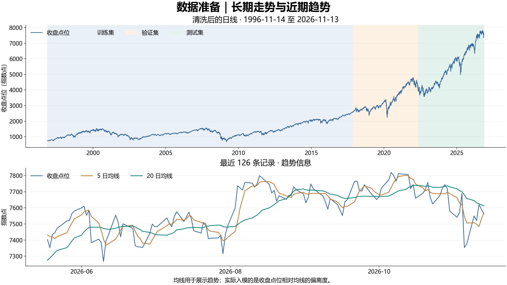
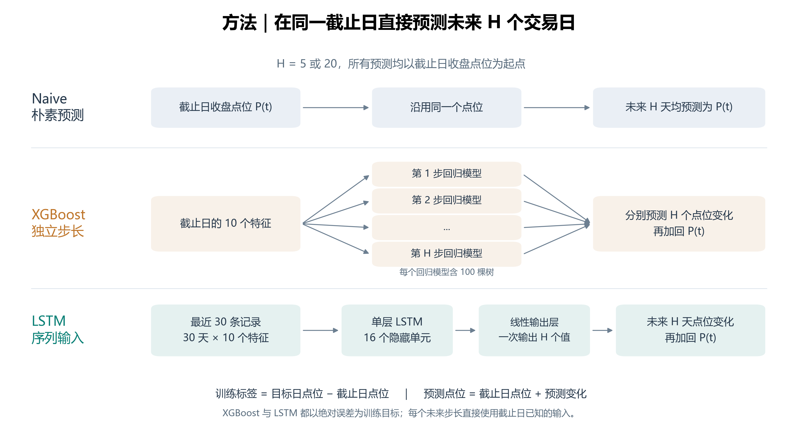
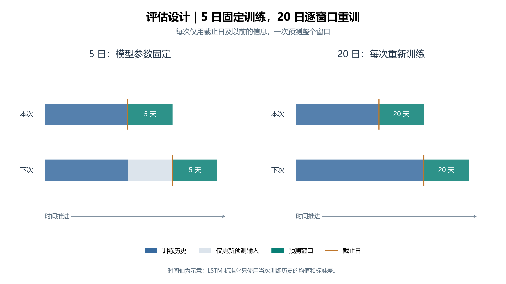
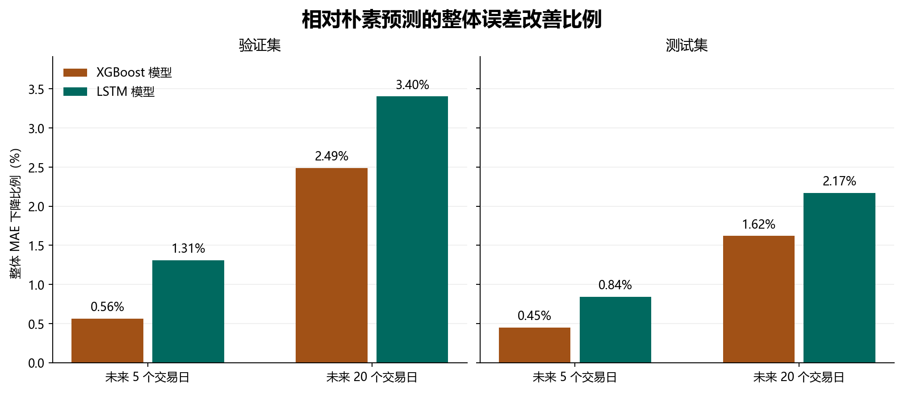
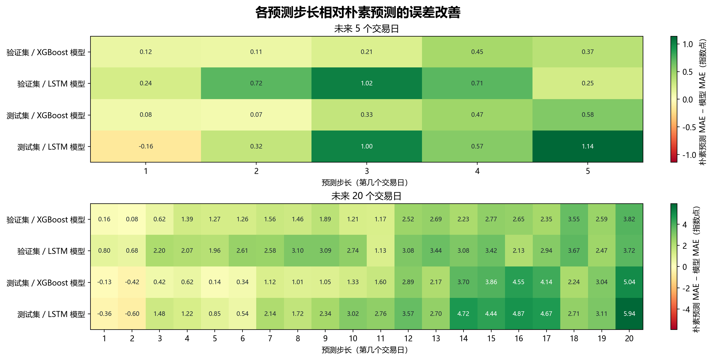

# 标普 500 收盘点位预测实验报告

本实验使用团队整理的标普 500 日线数据，比较 Naive、XGBoost 和 LSTM 对未来 5 个、20 个交易日收盘点位的预测表现。根据验证期与测试期的整体 MAE，课堂预测采用 LSTM。

## 1. 数据与预测任务

数据清洗和特征工程由团队的数据预处理模块完成。本实验读取 `data/processed/sp500_clean.csv` 和同目录下的 `sp500_features.csv`，前者用于核对日期和真实点位，后者提供模型输入。清洗表有 7,546 行，覆盖 1996-11-14 至 2026-11-13；特征表因 200 日均线的预热期删去前 199 行，保留 7,347 行。[项目说明](../../README.md)

| 时间切分 | 特征表行数 | 日期范围 |
| --- | ---: | --- |
| 训练集 | 5,083 | 1997-08-29 至 2017-11-08 |
| 验证集 | 1,132 | 2017-11-09 至 2022-05-10 |
| 测试集 | 1,132 | 2022-05-11 至 2026-11-13 |

预测从截止日收盘后开始，一次给出未来 5 个或 20 个交易日的每日点位，窗口内不再用新数据更新预测。最终输出为指数点位。

两种学习模型使用相同的 10 个特征，涵盖趋势、动量、价格位置、波动和短期收益变化。XGBoost 读取截止日的一行，LSTM 读取截至当日的最近 30 行。

| 类别 | 字段 | 表达的信息 |
| --- | --- | --- |
| 趋势，2 个 | `ma_ratio_5`、`ma_ratio_20` | 当前点位相对 5 日、20 日均线的偏离程度。 |
| 动量，1 个 | `rsi_14` | 近期上涨与下跌的相对强弱。 |
| 价格位置，1 个 | `bb_pctb_20` | 点位在布林带中的相对位置。 |
| 波动，1 个 | `vol_21_ann` | 最近 21 条收益率记录的年化波动率。 |
| 短期变化，5 个 | `log_ret_lag_1` 至 `log_ret_lag_5` | 前 1 至 5 条记录的对数收益率。 |



图 1 上半部分显示长期点位上升的同时伴有多次回撤；下半部分展示最近 126 条记录，蓝色为收盘点位，橙色为 5 日均线，绿色为 20 日均线。20 日均线较平滑，5 日均线更接近短期变化。均线在图中用于展示趋势，模型输入采用相对均线的偏离度。

评估和课堂预测的日期由 `exchange_calendars` 的 XNYS（纽约证券交易所）日历安排。现有数据中的 10 个特征均按当日及过去记录计算；分别截取两段历史重新计算后，所得特征与原表一致。

## 2. 预测方法

| 方法 | 训练与预测 |
| --- | --- |
| Naive | 将截止日收盘点位沿用到整个窗口。 |
| XGBoost | 每个步长训练一个回归模型：5 日训练 5 个，20 日训练 20 个。每个模型输入截止日的 10 个特征，使用 100 棵树、最大深度 2、学习率 0.03，目标为 `reg:absoluteerror`。 |
| LSTM | 输入最近 30 条记录 × 10 个特征，经单层 LSTM（16 个隐藏单元）和线性层，一次输出 5 或 20 个值。训练 25 轮，批量 128，Adam 学习率 0.003，损失为 `L1Loss`。 |

XGBoost 和 LSTM 学习的目标为“目标日收盘点位 − 截止日收盘点位”，预测后加回截止日点位。例如，截止日为 5,000 点，预测第 5 天变化为 +20 点，则第 5 天的预测点位为 5,020 点。每个步长都相对同一个截止日计算。

LSTM 将标签除以 100 后训练，预测时乘回 100。这一固定缩放不改变绝对误差的优化方向。两种模型都采用直接多步预测，不将前一步预测作为下一步输入。随机种子均为 42；XGBoost 无需特征标准化，LSTM 使用训练历史的均值和标准差进行标准化。



图 2 中，XGBoost 的每个分支对应一个步长的回归模型，每个模型内部包含 100 棵树；LSTM 则由一个网络同时输出整个窗口的点位变化。

## 3. 实验设置

| 实验 | 验证窗口 | 测试窗口 | 模型训练方式 |
| --- | ---: | ---: | --- |
| 5 日 | 226 | 219 | 仅用原训练集拟合，验证和测试期间参数固定；每个截止日更新预测输入。 |
| 20 日 | 56 | 54 | 每个截止日用截至当日的全部历史，从头训练 20 个 XGBoost 模型和一个 LSTM；超参数固定。 |



图 3 用两个相邻窗口说明训练方式。蓝色为训练历史，绿色为预测窗口，橙色竖线为截止日。5 日实验中，新增的灰色历史只更新预测输入；20 日实验中，新增历史参与下一次训练。时间轴不按实际长度绘制。

训练、验证、测试按时间顺序划分。首个验证截止日为 2017-11-08，首个测试截止日为 2022-05-10，之后每隔 5 个或 20 个交易日安排一个窗口。各窗口的目标日期不重叠，输入历史可以重叠，末尾不足一个完整窗口的记录不参与评估。

训练样本的输入和目标日都位于可用历史内，LSTM 的标准化参数也只根据当次训练历史计算。20 日实验推进到下一个截止日时，已经发生的验证或测试记录可以进入训练历史，尚未发生的目标记录不参与训练。

清洗表缺少 2023-05-24，本次未补填价格，也未修改原始 CSV。建模时先按 NYSE 交易日历检查跨度：XGBoost 的截止日至目标日必须连续，LSTM 的 30 个输入交易日与后续目标日也必须连续；不完整的训练样本被排除，再构造点位变化标签。

评估同时检查目标日期和截止日前的 30 个输入交易日。为公平比较，三种方法统一使用有效窗口：5 日测试从 225 个减为 219 个，20 日测试从 55 个减为 54 个，验证窗口数不变。下文指标、图表和演示模型均按修正后的规则重新生成。测试样本已变化，不能直接把新旧整体误差的差值归因于模型改善。

5 日训练集位于缺失日期之前，保留窗口的预测与旧版一致，整体指标变化来自窗口筛选。20 日实验还涉及训练样本调整，预测结果也随之变化。

## 4. 结果与分析

主要指标为收盘点位的 MAE，单位为指数点，越低表示平均误差越小。第 `h` 步 MAE 对所有窗口的第 `h` 天绝对误差取平均；整体 MAE 对全部窗口、全部步长取平均，也等于各步长 MAE 的平均值。

| 实验 | Naive | XGBoost | LSTM |
| --- | ---: | ---: | ---: |
| 5 日验证 | 45.0516 | 44.7981 | **44.4615** |
| 5 日测试 | 68.3109 | 68.0053 | **67.7361** |
| 20 日验证 | 74.8078 | 72.9458 | **72.2618** |
| 20 日测试 | 119.5602 | 117.6241 | **116.9678** |

20 日验证中，LSTM 在 **16/20** 个步长的 MAE 最低，XGBoost 在第 11、16、19、20 天领先。20 日测试中，Naive 在第 1、2 天领先，LSTM 在第 **3–20 天**领先。5 日测试中，XGBoost 在第 1 天领先，LSTM 在第 2–5 天领先。

相对 Naive 的改善比例为“（Naive MAE − 模型 MAE）÷ Naive MAE”。LSTM 在 5 日测试期的整体 MAE 降低约 0.84%，在 20 日测试期降低约 2.17%。



图 5 按步长展示“Naive MAE − 模型 MAE”。绿色正值表示模型误差较低，红色负值表示 Naive 误差较低。上下两幅热力图的色标范围不同，具体差异以格内数值为准。



### RMSE 与 R²

RMSE 为全部误差平方的平均值再开平方，单位为指数点，对较大的误差更敏感。R² 按 `1 − 误差平方和 / 真实点位相对均值的离差平方和` 计算。这里的整体指标将同一实验的所有窗口和步长合并计算。

| 实验 | 模型 | 整体 RMSE（点） | 整体 R² |
| --- | --- | ---: | ---: |
| 5 日验证 | Naive | **65.1191** | **0.991047** |
| 5 日验证 | XGBoost | 65.5096 | 0.990940 |
| 5 日验证 | LSTM | 65.4118 | 0.990967 |
| 5 日测试 | Naive | 95.7529 | 0.994069 |
| 5 日测试 | XGBoost | 95.4664 | 0.994105 |
| 5 日测试 | LSTM | **95.3879** | **0.994114** |
| 20 日验证 | Naive | **109.0918** | **0.974757** |
| 20 日验证 | XGBoost | 109.8595 | 0.974401 |
| 20 日验证 | LSTM | 110.0746 | 0.974300 |
| 20 日测试 | Naive | 158.6737 | 0.983481 |
| 20 日测试 | XGBoost | 157.4150 | 0.983742 |
| 20 日测试 | LSTM | **156.8892** | **0.983850** |

两个验证实验中，LSTM 的 MAE 最低，而 Naive 的 RMSE 更低，说明 LSTM 的平均绝对误差优势没有同时体现在平方误差上。两个测试实验中，LSTM 的 MAE 和 RMSE 均最低；20 日测试的 RMSE 比 Naive 低 1.78 点。

三种方法的点位 R² 都较高。评估期内的真实点位变化范围较大，而未来 5 日或 20 日点位通常仍靠近截止日，因此 Naive 也取得了较高的 R²。模型之间的差别主要体现在相对 Naive 的误差改善，较高的点位 R² 本身不代表涨跌方向预测准确。

5 日实验采用固定训练集，20 日实验采用扩展历史重训，两者的误差差异同时受到步长和训练方式影响。当前结果来自随机种子 42 的单次设置，尚未进行多次初始化或统计显著性检验，也没有单独测量预测滞后天数。

### 百分比误差 MAPE

MAPE 对每条绝对误差除以对应的真实点位，再取平均并乘以 100%。以下结果覆盖各测试窗口的全部预测步长。

| 测试实验 | Naive MAPE | LSTM MAPE |
| --- | ---: | ---: |
| 5 日 | 1.3004% | 1.2906% |
| 20 日 | 2.2825% | 2.2370% |

百分比误差与点位 MAE 的单位不同，均显示 LSTM 相对 Naive 有小幅改善。完整指标见 [metrics/](metrics/)，百分比误差结果见 [test_percentage_errors.json](test_percentage_errors.json)。

## 5. 模型选择与课堂预测

课堂预测需要提交整个窗口的逐日点位，本实验以整体 MAE 作为选模依据。LSTM 在四组验证、测试结果中的整体 MAE 均最低，因此采用 LSTM。20 日测试中，它比 Naive 的 MAE 低 2.17%，比 XGBoost 低 0.66 点。改善幅度有限，且前两个步长仍由 Naive 领先。

运行 [ClassroomForecast.py](../../src/1_TimeSerialAnalyze/ClassroomForecast.py)，输入截止日、窗口开始日和结束日（`YYYY-MM-DD`）。脚本默认使用截止日及以前的全部历史重新训练 LSTM，再按 NYSE 交易日历输出点位。截止日为休市日时回退至此前最近的交易日。当前特征表截至 2026-11-13，使用更晚的交易日作为截止日需要更新数据。

模型保存在 `src/1_TimeSerialAnalyze/models/lstm_截止日_步长day.pt`，包括权重、标准化参数、特征清单、训练配置、截止日和日期对齐版本。旧版模型需重训后再加载。预测结果保存在 `reports/1_TimeSerialAnalyze/forecast_window.csv`，列为 `date`、`step` 和 `predicted_close`。`step` 从截止日后的首个交易日起算。

当前 CSV 是截止 2026-11-13、预测 2026-11-16 至 2026-11-20 的 5 日演示结果。保存的模型可以重现该文件。老师指定的正式窗口尚未公布，最终提交文件需要在窗口确定后重新生成。现有独立测试覆盖 5 日和 20 日预测，其他长度的输出尚无同长度的测试结果。

## 6. 复现入口

从头运行 [TimeSeriesAnalysis.ipynb](../../src/1_TimeSerialAnalyze/TimeSeriesAnalysis.ipynb)，可完成数据读取、模型训练、四组评估、绘图和演示预测。Notebook 与独立脚本使用同一套模型和评估函数。运行依赖 NumPy、pandas、PyTorch、XGBoost、Matplotlib、exchange-calendars 和 Jupyter 内核。

当前本地目录未包含 `pyproject.toml` 和 `uv.lock`；课程要求的 `uv sync` 环境配置还需在团队仓库中确认或补齐。

| 文件 | 用途 |
| --- | --- |
| [ForecastModels.py](../../src/1_TimeSerialAnalyze/ForecastModels.py) | 特征清单、XGBoost/LSTM 训练、模型保存与加载。 |
| [EvaluateForecastMetrics.py](../../src/1_TimeSerialAnalyze/EvaluateForecastMetrics.py) | 数据读取、窗口安排、三种方法评估与指标计算。 |
| [ClassroomForecast.py](../../src/1_TimeSerialAnalyze/ClassroomForecast.py) | 指定日期预测、模型保存与 CSV 导出。 |
| [EvaluatePercentageErrors.py](../../src/1_TimeSerialAnalyze/EvaluatePercentageErrors.py) | 计算有效测试窗口上的 MAPE，并复用预测缓存。 |
| [PlotForecastMAE.py](../../src/1_TimeSerialAnalyze/PlotForecastMAE.py) | MAE 改善比例柱状图和逐步长热力图。 |
| [PlotPresentationFigures.py](../../src/1_TimeSerialAnalyze/PlotPresentationFigures.py) | 数据趋势、模型结构和评估时间轴配图。 |

以下命令分别运行 20 日测试、5 日演示预测，以及两组绘图程序：

```powershell
python src/1_TimeSerialAnalyze/EvaluateForecastMetrics.py --horizon 20 --split test
python src/1_TimeSerialAnalyze/ClassroomForecast.py 2026-11-13 2026-11-16 2026-11-20
python src/1_TimeSerialAnalyze/PlotForecastMAE.py
python src/1_TimeSerialAnalyze/PlotPresentationFigures.py
```

评估脚本的 `--horizon` 可取 5 或 20，`--split` 可取 val 或 test，`--output` 可保存整体及逐步长 MAE、RMSE、R² 的 JSON 文件。课堂脚本的 `--model` 可加载已保存模型，`--output` 可指定 CSV 路径。Notebook 的图使用当次运行结果，独立误差绘图脚本使用已记录的 MAE。

日期对齐的六项回归检查可运行：

```powershell
python -m unittest discover -s src/1_TimeSerialAnalyze/tests -v
```
