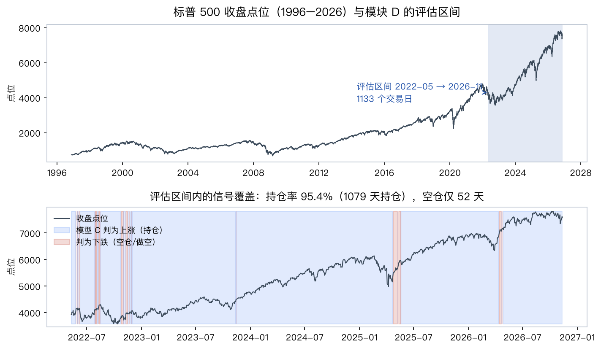
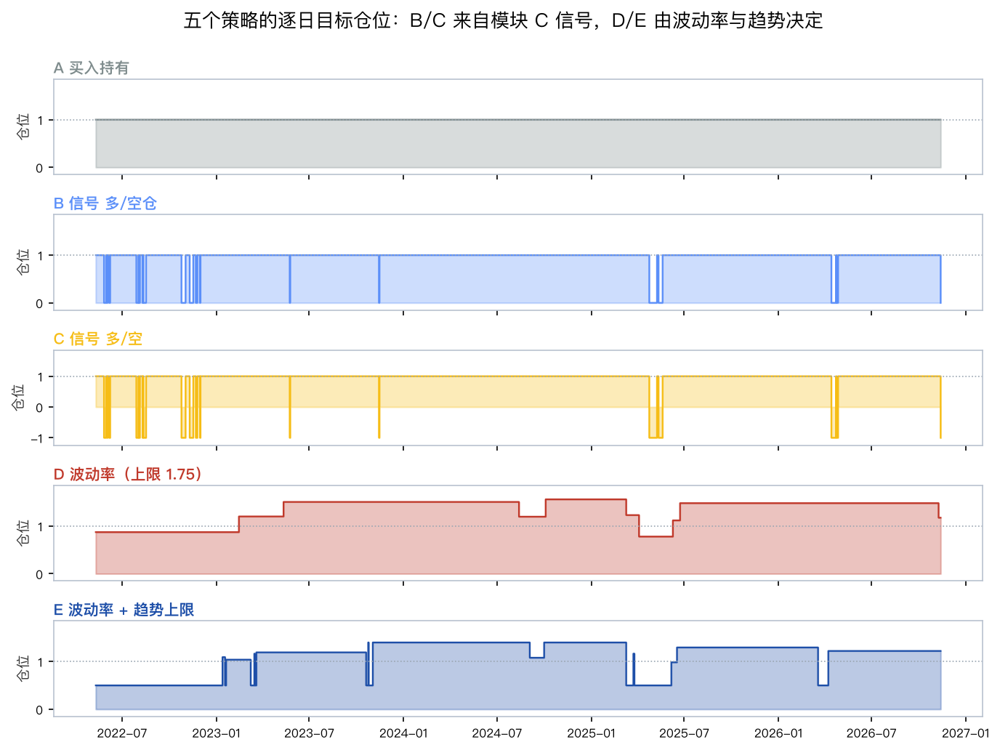
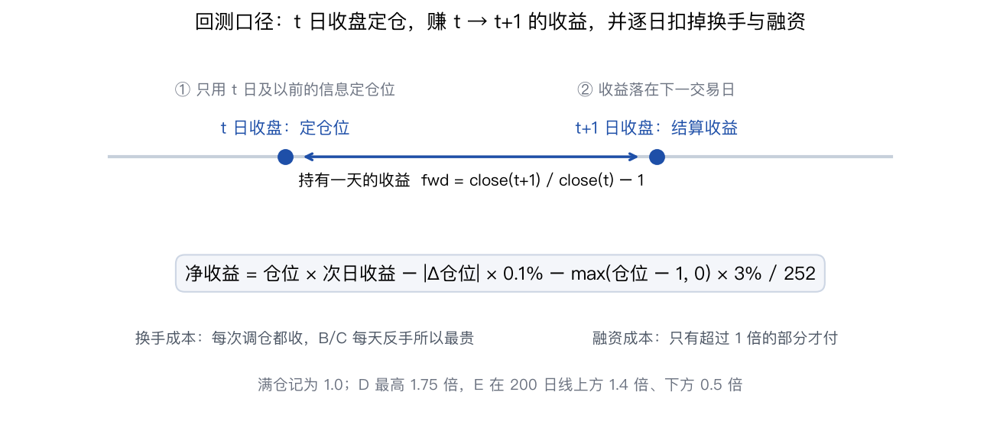
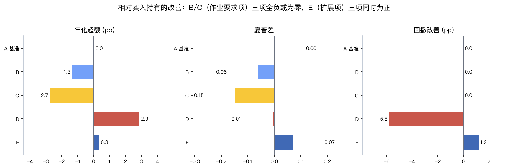
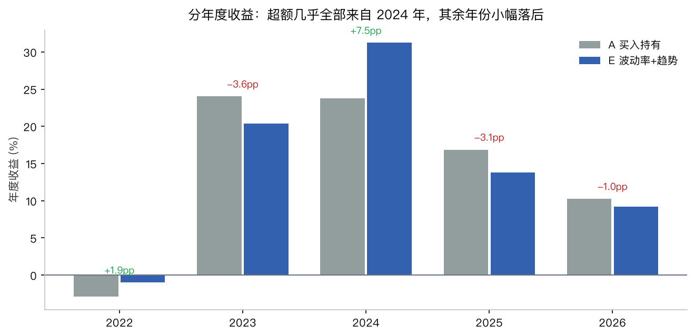
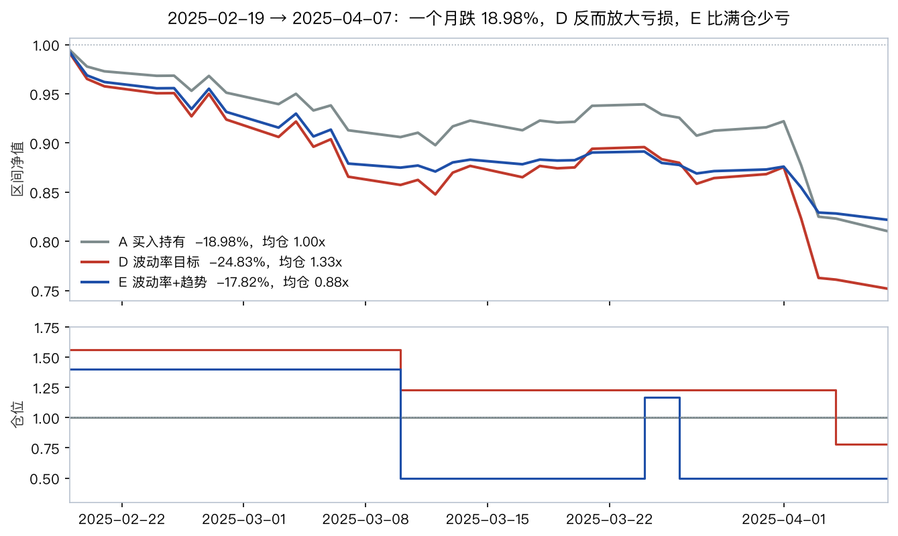

# 标普 500 交易策略与回测实验报告

本实验使用团队整理的标普 500 日线数据和模块 C 输出的涨跌分类信号，构造并回测五个仓位规则：买入持有（基准）、两个信号策略（作业要求项 B、C）、两个波动率策略（扩展项 D、E）。评估区间为 2022-05-11 至 2026-11-13，共 1,133 个交易日，全部结果扣除 0.1% 单边成本与 3% 融资利息。[项目说明](../../README.md)

## 1. 数据与信号

价格数据为 `data/SP500_daily.csv`，7,547 条记录，覆盖 1996-11-14 至 2026-11-13。评估区间不是全样本，而是模块 C 信号存在的区间：信号由分类模型在测试集上逐日给出，只有这段区间才有可用的 `pred_up`，因此五个策略都在这 1,133 天上比较。

| 输入 | 行数 | 覆盖区间 | 用途 |
| --- | ---: | --- | --- |
| `data/SP500_daily.csv` | 7,547 | 1996-11-14 至 2026-11-13 | 收盘价，计算收益与均线 |
| `reports/2_RiseFallForecast/signals/test_signals.csv` | 1,131 | 2022-05-11 至 2026-11-12 | 模块 C 的 `pred_up` 信号 |

1,133 个交易日中有 2 天没有信号：2023-05-24 在信号表里缺失（模块 C 的特征表没有该日，`target_date` 由 05-23 直接跳到 05-25，而行情表里该日存在），2026-11-13 是信号末端未覆盖，这两天按空仓处理。它们只影响 B、C，不影响 D、E（后两者的仓位由波动率与趋势决定，与信号无关）。影响并不为零：若把 2023-05-24 按满仓处理，B 的累计收益从 82.18% 升到 84.14%（+1.96pp），2026-11-13 再影响 0.18pp。方向上这是**低估**了 B、C 的表现，但不改变它们跑输基准的结论。持仓率 95.4% 按 1,131 个有信号的交易日统计，即 1,079 天判为上涨、52 天判为下跌。



图 1 上半部分标出评估区间在 30 年历史中的位置；下半部分在评估区间内用颜色标注信号：蓝色为判涨（持仓），红色为判跌（空仓或做空）。信号极少给出下跌判断，空仓只有 52 天，这一点直接决定了 B、C 的表现。

## 2. 五个策略

| 编号 | 仓位规则 | 角色 |
| --- | --- | --- |
| A | 恒为 1.0 | 买入持有，基准 |
| **B** | 信号为 1 → 满仓，为 0 → 空仓 | 作业要求项 |
| **C** | 信号为 1 → 做多，为 0 → 做空 | 作业要求项 |
| D | 20% ÷ 近 40 日年化波动率，杠杆上限固定 1.75 | 扩展项 |
| **E** | 同上，杠杆上限随趋势：200 日线上方 1.4、下方 0.5 | 扩展项 |

D、E 不使用分类信号，只依赖两个当日可估的量：波动率（当前有多颠）和 200 日均线（当前往哪走）。目标仓位写为

```
目标仓位 = min( 20% ÷ 年化波动率 , 杠杆上限 )
```

波动率为近 40 个交易日对数收益的标准差乘 √252。若目标仓位与当前仓位之差不超过 30%，则维持不动，这条缓冲带把 D 的累计换手从 20.5 降到 4.0，E 从 17.4 降到 13.4。

D 与 E 使用同一个 40 日波动率、同一条 0.30 缓冲带，唯一区别是杠杆上限：D 固定 1.75，E 由趋势决定（1.4 或 0.5）。因此两者之差可以单独归因于趋势约束，不需要额外的控制变量。



图 2 从上到下依次为 A 至 E。B、C 的仓位在 0 与 1（或 −1）之间跳变，2025 年 3 月前后有一次明显的反复；D 长期在 1.0–1.5 之间，2025 年初急跌时反而加到 1.5 附近；E 在同样的位置降到 0.5。

## 3. 回测口径

回测按四条规则执行，任一条写错结果都不可信。

| 规则 | 实现 |
| --- | --- |
| 时点对齐 | t 日收盘确定仓位，赚 t → t+1 的收益，`fwd = close.shift(-1) / close - 1` |
| 换手成本 | `abs(Δ仓位) × 0.1%`，建仓、平仓、反手都收 |
| 融资成本 | `max(仓位 − 1, 0) × 3% / 252`，只有加杠杆的部分付息 |
| 净值与回撤 | 净收益累乘得净值，净值除以历史最高点减一得回撤 |

净收益因此是一行：

```
净收益 = 仓位 × 次日收益 − |Δ仓位| × 0.1% − max(仓位 − 1, 0) × 3% / 252
```



### 指数不可交易

标普 500 是价格指数，不能直接买卖。本实验是**信号级回测**：按指数收盘价足额成交，检验规则本身有没有价值，不模拟点差、滑点和合约展期。实操对应 SPY（融资成本约 6%）或 ES 期货（约 3%），本文取 3%，并在第 6 节给出 4.5% 与 6% 的结果。指数不含股息，这对平均仓位 1.11 倍的 E 略不利，对满仓的 A 影响约每年 1.3 个百分点，方向上是**低估**了 E 的相对表现。

### 为什么以买入持有为基准

作业要求以 Buy & Hold 作为对照。它也是最严格的基准：同期年化 15.61%、夏普 0.96，是 2022 年以来一轮强牛市的结果。任何策略要证明自己有价值，必须在这段区间里至少不输给它；只和 0 收益比较没有意义。

## 4. 结果

| 策略 | 年化 | 年化波动 | 夏普 | 最大回撤 | 卡玛 | 期末净值 |
| --- | ---: | ---: | ---: | ---: | ---: | ---: |
| A 买入持有 | 15.61% | 16.54% | 0.960 | −18.90% | 0.826 | 1.92x |
| B 信号 多/空仓 | 14.27% | 16.31% | 0.900 | −18.90% | 0.755 | 1.82x |
| C 信号 多/空 | 12.86% | 16.56% | 0.813 | −18.90% | 0.680 | 1.72x |
| D 波动率目标 | **18.47%** | 19.84% | 0.954 | −24.71% | 0.747 | **2.14x** |
| E 波动率+趋势 | 15.94% | **15.55%** | **1.029** | **−17.71%** | **0.900** | 1.94x |

| 策略 | 笔数 | 胜率 | 盈亏比 | 平均仓位 | 累计换手 | 成本拖累(年化) | 回撤改善 |
| --- | ---: | ---: | ---: | ---: | ---: | ---: | ---: |
| A 买入持有 | 1 | — | — | 1.00 | 1.0 | 0.02pp | — |
| B 信号 多/空仓 | 18 | 94.4% | 0.46 | 0.95 | 36.0 | 0.80pp | **+0.00pp** |
| C 信号 多/空 | 36 | 63.9% | 2.21 | 0.90 | 71.0 | 1.58pp | **+0.00pp** |
| D 波动率目标 | 10 | 70.0% | 2.72 | 1.33 | 3.97 | 1.18pp | −5.81pp |
| E 波动率+趋势 | 21 | 66.7% | 3.75 | 1.11 | 13.4 | 0.96pp | **+1.19pp** |

一笔交易定义为“仓位不变的一段”，胜率为正收益笔数占比，盈亏比为平均盈利 ÷ 平均亏损绝对值。

B、C 都跑输基准，且最大回撤与基准**完全相同**。B 胜率高达 94.4%，但盈亏比只有 0.46：赚的时候赚一点，亏的时候亏更多，18 笔交易里少数几笔大亏吃掉了全部优势。C 把空仓换成做空，胜率降到 63.9%，换手翻倍到 71 次，成本拖累升到 1.58 个百分点，年化进一步降到 12.86%。

D 的收益最高（18.47%），但代价是回撤从 −18.90% 恶化到 −24.71%，夏普 0.954、卡玛 0.747 都低于基准——它只是把仓位整体放大到 1.33 倍，牛市里收益被放大，下跌时亏损同时被放大。

E 是唯一在收益、夏普、回撤、卡玛四项同时优于基准的策略：年化 15.94% 对 15.61%，夏普 1.029 对 0.960，最大回撤 −17.71% 对 −18.90%，卡玛 0.900 对 0.826。



图 4 三个面板分别为年化超额、夏普差和回撤改善。B、C 三项全部为零或负；D 收益为正但回撤为负；只有 E 三项同时为正（+0.3pp、+0.07、+1.2pp）。



图 5 按自然年拆分（2022 年从 5 月起、2026 年截至 11 月 13 日，均为不完整年度）。E 只在 2022 年（+1.9pp）和 2024 年（+7.5pp）领先，2023、2025、2026 年分别落后 3.6、3.1、1.0 个百分点。若剔除 2024 年，A 累计 +55.1%、E 累计 +48.2%，E 转为落后约 7 个百分点。**超额高度集中在一个年份，这是本报告最主要的局限。**

## 5. 最大回撤是否改善

作业特别关注这一点，答案是：**B、C 改善 +0.00pp，与基准完全相同。**

原因是仓位结构而非模型精度。B 的平均仓位 0.95、持仓时间 95.2%，1,133 天里只有 54 天不在场，其中 52 天来自信号判跌；最大回撤发生在 2025-02-19 至 2025-04-07，34 个交易日指数下跌 18.98%，而这段时间信号一天都没有给出下跌判断，所以 B 的回撤曲线与基准完全重合。C 加了做空也没有改善，因为信号判跌的日子并不对应系统性下跌，做空反而在反弹中亏得更多。

| | A 买入持有 | B 信号 多/空仓 | C 信号 多/空 | D 波动率目标 | E 波动率+趋势 |
| --- | ---: | ---: | ---: | ---: | ---: |
| 窗口平均仓位 | 1.00 | 1.00 | 1.00 | 1.33 | 0.88 |
| 窗口收益 | −18.98% | −18.98% | −18.98% | **−24.83%** | **−17.82%** |



图 6 上半部为区间净值，下半部为同期仓位。D 的波动率是事后统计量，跌出来才升上去，在下跌初期仍挂着 1.33 倍，亏损被放大到 −24.83%；E 在指数跌破 200 日线时就把上限降到 0.5，平均仓位 0.88，只亏 −17.82%，比满仓的基准还少亏 1.2 个百分点。这一条差异就是 E 相对 D 的全部来源：同一条波动率规则、同一条缓冲带，仅增加趋势条件，回撤改善 7.00 个百分点，代价是年化少 2.53 个百分点。

## 6. 稳健性与局限

**融资成本。** E 的超额依赖杠杆成本。把 3% 换成 4.5%，年化优势消失（−0.05pp）；换成 6%（SPY 的实际水平），落后 0.43 个百分点。但回撤改善（+1.2pp）、夏普优势（1.029 对 0.960）在两个更高成本下都保持，说明 E 的价值主要来自风险结构而不是收益放大。

| 融资年化 | A 年化 | E 年化 | E 夏普 | E 最大回撤 | 超额 |
| --- | ---: | ---: | ---: | ---: | ---: |
| 3.0% | 15.61% | 15.94% | 1.029 | −17.71% | +0.33pp |
| 4.5% | 15.61% | 15.56% | 1.008 | −17.74% | −0.05pp |
| 6.0% | 15.61% | 15.18% | 0.987 | −17.76% | −0.43pp |

**样本与市场环境。** 只有 2022-05 至 2026-11 一个区间，且是强牛市，基准年化 15.61% 本身很高；换到更长样本或高波动、长期震荡的年代，结论可能不同。这段区间内没有出现 2008 年或 2020 年那样的深度回撤，趋势规则在那种环境下的表现未被检验。

**参数与多重检验。** 波动率窗口 40 日、目标波动 20%、缓冲带 0.30、趋势上限 1.4/0.5 都是先验设定，没有在这段区间上做网格搜索，因此不存在“调参调到好看”的问题；但也意味着这些取值没有经过优化，同一套规则换一个市场未必合适。

**执行层面。** 回测按收盘价足额成交，未计入点差、滑点、期货展期和保证金占用；E 的平均仓位 1.11 倍，实盘中需要留出保证金缓冲，实际可实现的杠杆会低于回测。

## 7. 复现入口

从头运行 [TradingStrategy_Backtesting.ipynb](../../src/3_TradingStrategy_Backtesting/TradingStrategy_Backtesting.ipynb)，可完成数据读取、仓位构造、回测、指标表与绘图，共 7 个代码单元、48 行代码（不计空行）。Notebook 是精简演示版，下列脚本产出 `metrics/`、`positions/` 与全部配图，两者使用同一套常量与规则。

| 文件 | 用途 |
| --- | --- |
| [StrategyRules.py](../../src/3_TradingStrategy_Backtesting/StrategyRules.py) | 参数、数据与信号读取、缓冲带、五个策略的仓位。 |
| [BacktestEngine.py](../../src/3_TradingStrategy_Backtesting/BacktestEngine.py) | 净收益、净值、回撤、指标与逐笔交易。 |
| [EvaluateStrategyMetrics.py](../../src/3_TradingStrategy_Backtesting/EvaluateStrategyMetrics.py) | 生成 `metrics/*.json` 与 `positions/*.csv`。 |
| [PlotPresentationFigures.py](../../src/3_TradingStrategy_Backtesting/PlotPresentationFigures.py) | 生成 slide1–slide3 与结果图。 |

以下命令在项目根目录执行：

```powershell
python src/3_TradingStrategy_Backtesting/EvaluateStrategyMetrics.py
python src/3_TradingStrategy_Backtesting/PlotPresentationFigures.py
```

两个脚本都支持 `--output-dir`，默认写入 `reports/3_TradingStrategy_Backtesting`。

| 产物 | 内容 |
| --- | --- |
| [metrics/test_metrics.json](metrics/test_metrics.json) | 五策略全部指标、参数、数据指纹、信号覆盖。 |
| [metrics/benchmark_comparison.json](metrics/benchmark_comparison.json) | 相对买入持有的年化超额、夏普差、回撤改善、卡玛差。 |
| [metrics/year_by_year.json](metrics/year_by_year.json) | 分年度收益。 |
| [metrics/cost_sensitivity.json](metrics/cost_sensitivity.json) | 融资成本 3% / 4.5% / 6% 下的结果。 |
| [metrics/drawdown_window_2025.json](metrics/drawdown_window_2025.json) | 2025-02-19 至 2025-04-07 的仓位与收益。 |
| [positions/positions_test.csv](positions/positions_test.csv) | 逐日目标仓位（列 A–E）。 |
| [positions/equity_test.csv](positions/equity_test.csv) | 逐日净值与回撤（列 eq_A–eq_E、dd_A–dd_E）。 |
| [positions/trades_test.csv](positions/trades_test.csv) | 逐笔交易明细：起止日期、天数、平均仓位、净收益。 |

`src/3_TradingStrategy_Backtesting/TradingStrategy_Backtesting.py` 已拆分为上述四个模块，文件内只保留说明，不再包含逻辑。旧版本（S0–S3 策略、2016–2026 全样本）的图与表与当前结论不一致，已从交付中剔除、没有进入仓库，以免与本文数字混淆。
